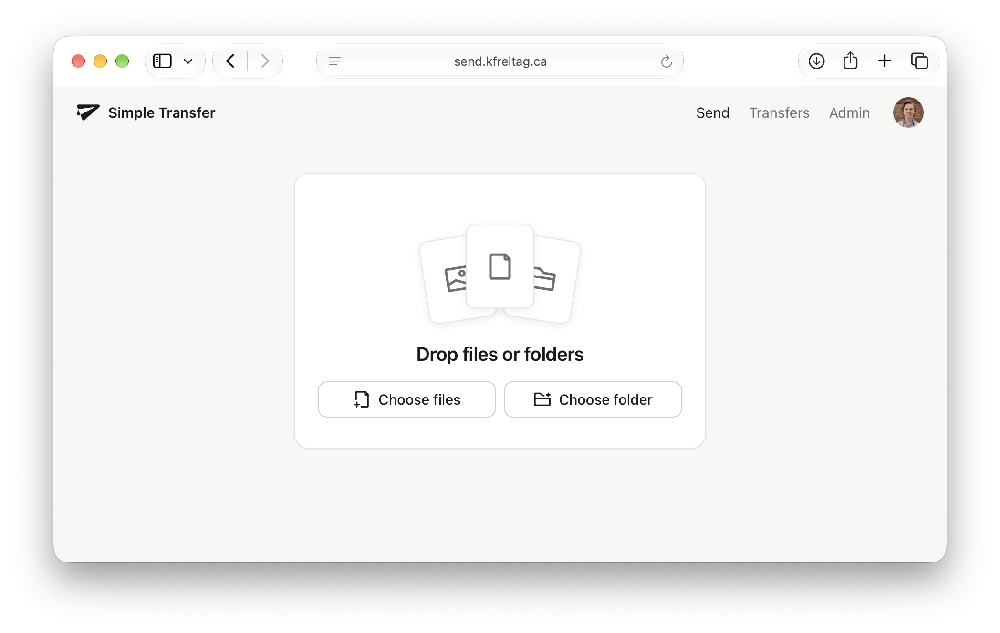

# Simple Transfer

Self-hosted file sending (like WeTransfer). Sign in, drop files or folders, get a link. Anyone can then download until it expires

<p align="center">
  
</p>

## Features

- **Resumable uploads.** Dropped connections retry automatically, and after a reload/crash you pick the same files again and continue
- **Password and expiry** per transfer, both optional
- **Downloads** per file (with `Range`, so they can be paused and resumed), or everything as a streamed zip
- **Limits.** Maximum transfer size, storage quota, and maximum/default expiry, set globally and overridden per role/user
- **Admin panel.** Users (roles, bans), transfers, limits, usage, branding, release notes
- **Branding.** Instance name, light and dark accent colours, and logo

https://github.com/user-attachments/assets/9b0e3355-f8a6-49de-8039-d53dff165fd9


## Run it

You need Docker and an OIDC provider

1. At the provider, make an OIDC client. Sign-in is the authorization code flow with PKCE, so require PKCE if given a choice to do so (client secrets are optional)

   Redirect URI is `<BASE_URL>/api/auth/callback/oidc`, if not auto detected (e.g. with Pocket ID, Authentik)

2. Download the compose file and make a `.env`:

   ```sh
   curl -O https://raw.githubusercontent.com/kfreitag1/simple-transfer/main/compose.yaml
   ```

   ```ini
   BASE_URL=https://files.example.com

   # openssl rand -hex 32
   AUTH_SECRET=

   OIDC_ISSUER=https://id.example.com
   OIDC_CLIENT_ID=
   # Leave empty for a public client
   OIDC_CLIENT_SECRET=
   OIDC_PROVIDER_NAME=Authentik

   # Only if behind a reverse proxy
   TRUST_PROXY=true
   ```

3. Let 'er rip bud:

   ```sh
   docker compose up -d
   ```

4. Put a reverse proxy with TLS in front (default port 3000) and sign in. **The first person to sign in becomes an admin**

Everyone your ID provider authenticates gets an account, restrict at the provider level if needed

### Env var configuration

| Variable | Default | |
|---|---|---|
| `BASE_URL` | required | Public origin of the instance |
| `AUTH_SECRET` | required | At least 32 characters. Signs sessions and unlock cookies |
| `OIDC_ISSUER` | required | Issuer URL |
| `OIDC_CLIENT_ID` | required | |
| `OIDC_CLIENT_SECRET` | | Unset for a public client, which uses PKCE alone |
| `OIDC_SCOPES` | `openid profile email` | Space separated |
| `OIDC_PROVIDER_NAME` | | Button has "Sign in with *name*" |
| `TRUST_PROXY` | `false` | Take the client IP from `X-Forwarded-For`. Rate limits depend on it |
| `TRUSTED_ORIGINS` | | Further origins allowed to call the auth API (for dev) |
| `PORT` | `3000` | |
| `DB_PATH` | `/data/db/app.sqlite` | Set by the image |
| `STORAGE_DIR` | `/data/files` | Set by the image |

Any variable can be also read from a file by setting `<NAME>_FILE`, e.g. for docker secrets: `OIDC_CLIENT_SECRET_FILE=/run/secrets/oidc_client_secret`

### Reverse proxy

- Allow request bodies of at least 16 MiB (nginx: `client_max_body_size 20m;`)
- Don't buffer responses, or large downloads will be spooled to the proxy's disk first (nginx: `proxy_buffering off;`). Not buffering requests either saves the same for uploads (`proxy_request_buffering off;`)
- Set `X-Forwarded-For`, and set `TRUST_PROXY=true` so that per-IP rate limits work. Set as `false` if the container is reachable directly
- Don't cache API responses. They are sent `Cache-Control: private, no-store`, but a proxy configured to cache regardless could serve a password-protected download without the unlock cookie
- Transfer URLs are share secrets: the app sends `Referrer-Policy: no-referrer` and `X-Robots-Tag: noindex`, and `robots.txt` disallows crawlers. Don't publish links you want kept private

E.g. a minimal Caddyfile:

```caddyfile
send.example.com {
    reverse_proxy 127.0.0.1:3000
}
```

Caddy handles TLS and sets `X-Forwarded-For`; no extra body-size or buffering directives are needed. Set `BASE_URL=https://files.example.com` and `TRUST_PROXY=true`. If Caddy runs in compose on the same network, use `reverse_proxy app:3000` instead

### Data

| Mount | Compose variable | Holds |
|---|---|---|
| `/data/db` | `DB_DIR` (default `./data/db`) | SQLite db. Put on reliable + fast (e.g. boot drive) |
| `/data/files` | `FILES_DIR` (default `./data/files`) | Uploaded files (e.g. on larger SSD/HDD) |

Expired transfers and uploads abandoned for 24 hours are deleted by a sweep every five mins

### Updating

```sh
docker compose pull && docker compose up -d
```

## Development

Needs [Bun](https://bun.sh) (version pinned in `Dockerfile`) and docker for the mock OIDC provider

```sh
bun install
cp .env.example .env                       # then fill in AUTH_SECRET
docker compose -f compose.dev.yaml up -d   # mock provider on :8080; any username signs in
bun run dev                                # API on :3000, vite on http://localhost:5173
```

| | |
|---|---|
| `bun run check` | Lint, typecheck and tests. Same as CI |
| `bun run fix` | Apply formatting and safe lint fixes |
| `bun test <path>` | One test file |
| `bun run db:generate` | New migration after editing `apps/server/src/db/schema.ts` |
| `bun run build` | Build web app; `bun run start` then serves everything on `PORT` |

```
packages/shared   Shared types, limits, error codes, path rules, and the uploader
apps/server       Elysia API, Better Auth, Drizzle on bun:sqlite, storage, sweeper
apps/web          Solid.js SPA built with vite
```

[ARCHITECTURE.md](ARCHITECTURE.md) specifies the behaviour, the API and the upload protocol, and explains the decisions behind them. Read it before changing anything, and update it when a change alters what it describes

Several dependencies are pinned to pre-releases (Elysia 2, Solid 2, Solid Router 2). [AGENTS.md](AGENTS.md) lists where their APIs differ

The web app targets current browsers and has no fallbacks for older ones

[AI:W](https://0rwx.com/)

## License

[MIT](LICENSE)
